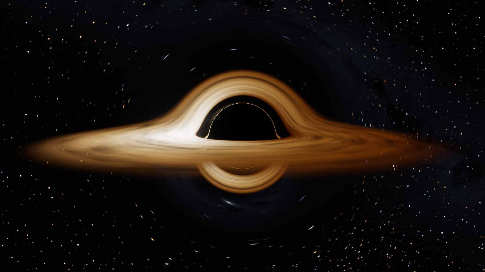
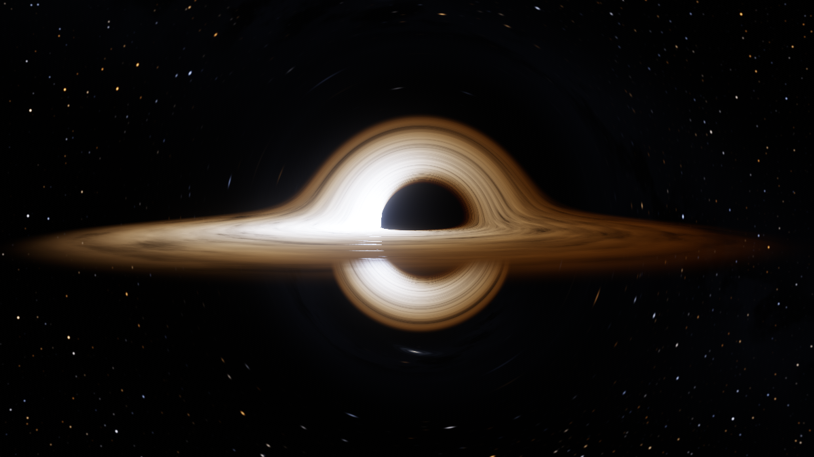
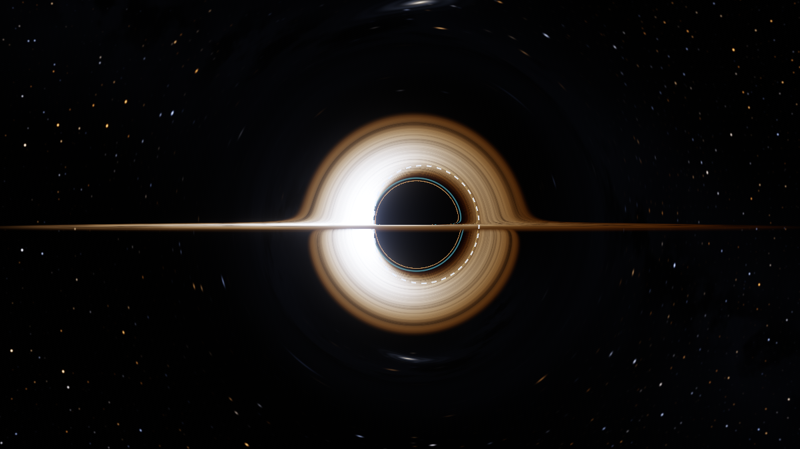
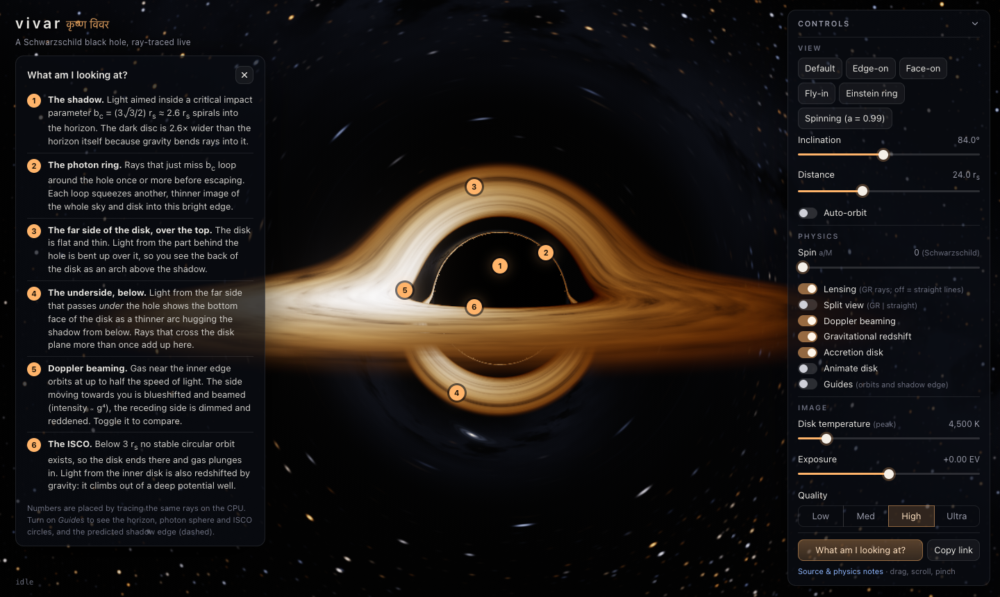
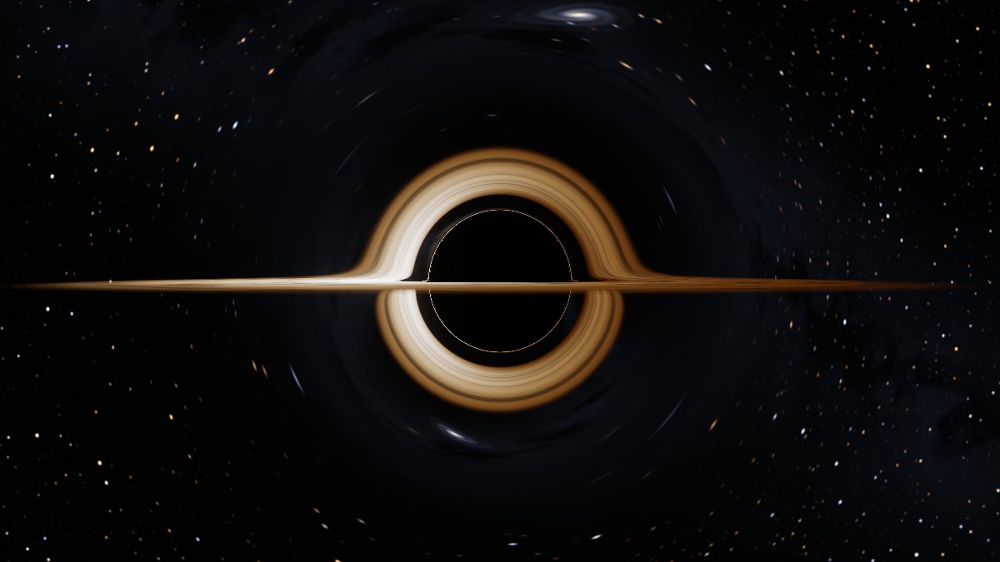
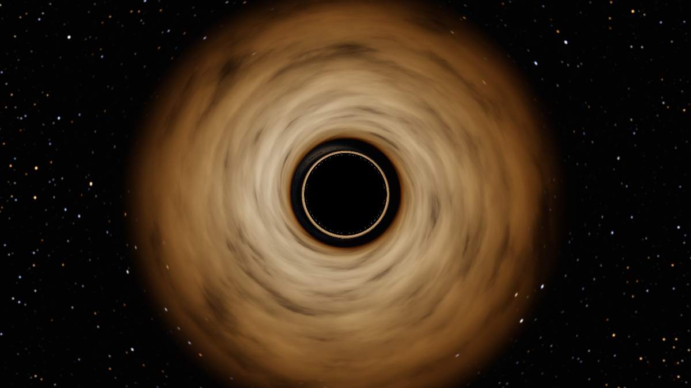
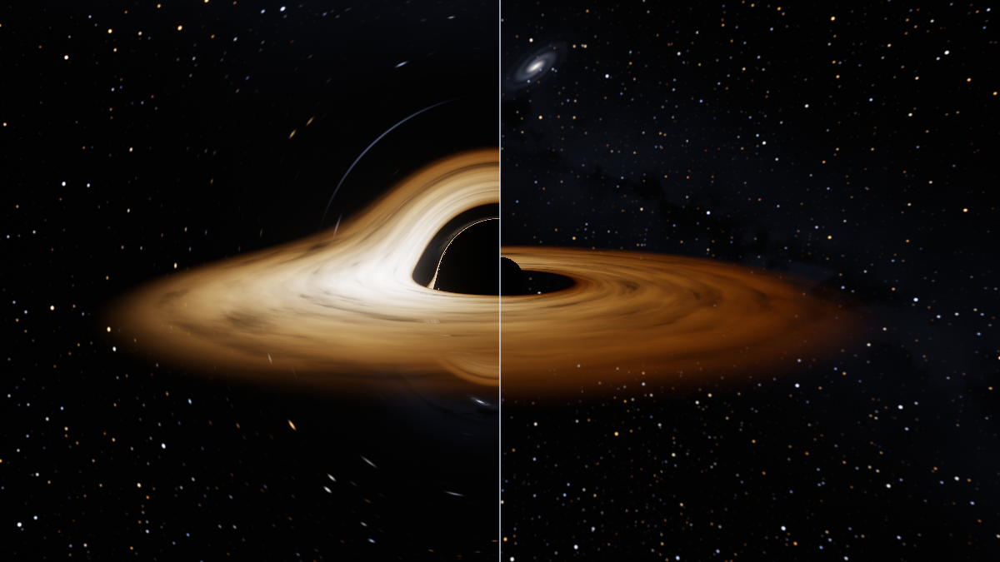
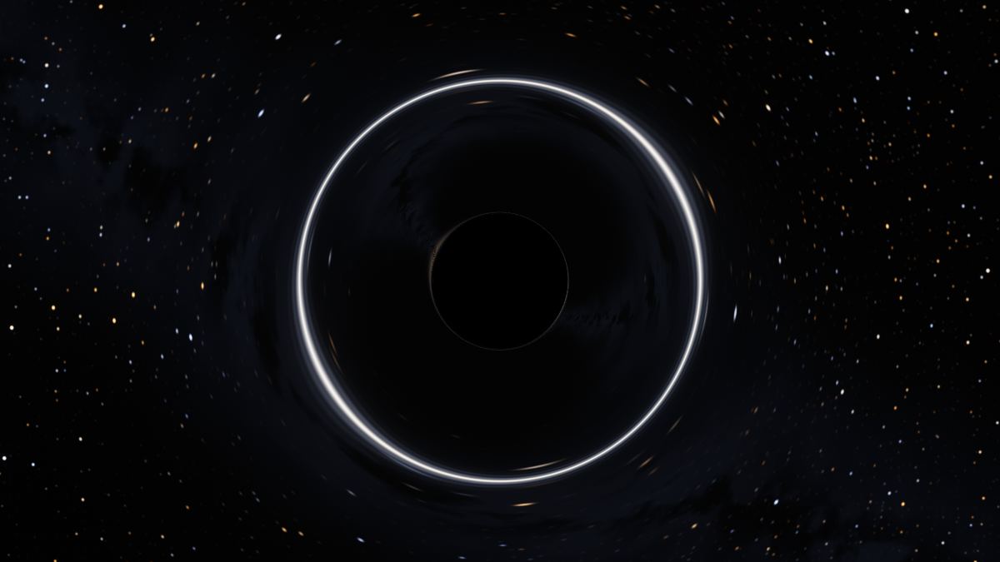
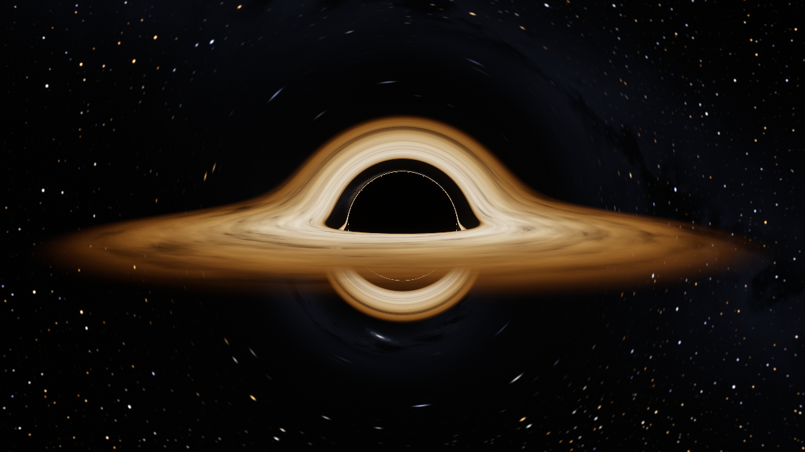

# vivar · कृष्ण विवर

*Krishna vivar* is Hindi for "black hole" (literally "black cavity").

[](https://samarthjaiswal.github.io/vivar/)
[](https://github.com/SAMARTHJAISWAL/vivar/actions/workflows/ci.yml)
[](LICENSE)

vivar renders a black hole with a thin accretion disk in real time, in the browser: a non-spinning
(Schwarzschild) hole, or a spinning (Kerr) one up to $a/M = 0.998$. For every pixel, a WebGL2 fragment shader
traces a light ray backwards from the camera through curved spacetime, integrating the null-geodesic equations
step by step until the ray falls through the horizon or escapes to the sky. Nothing in the image is painted on:
the shadow (round, or D-shaped with spin), the photon ring, the disk bent over the top of the hole and the bright
approaching side all come out of the ray tracing.

**Live: <https://samarthjaiswal.github.io/vivar/>**



<sub>Rendered by the app in headless Chromium at 1600×900, Ultra quality, peak disk temperature 4,500 K, inclination 84°.</sub>

## What you are seeing

| | |
|---|---|
| **Shadow** | The dark disc. Light aimed inside the critical impact parameter $b_c = \tfrac{3\sqrt3}{2}\,r_s \approx 2.598\,r_s$ spirals into the horizon. The shadow is about 2.6 times wider than the horizon because gravity bends rays into it. |
| **Photon ring** | The thin bright line at the shadow's edge. Rays that just miss $b_c$ loop around the hole one or more times before escaping, so each extra loop squeezes another, thinner image of the disk and sky into it. |
| **Disk over the top** | The disk is flat. Light from the part *behind* the hole is bent up over it, so the back of the disk shows as the arch above the shadow. |
| **Disk underneath** | Light from the far side that passes *under* the hole shows the disk's bottom face as the arc below the shadow. Rays that cross the disk plane more than once add their contributions. |
| **Doppler asymmetry** | Gas near the inner edge orbits at up to half the speed of light. The side moving towards you (the left, in the default view) is blueshifted and beamed; the receding side is dimmer and redder. |
| **ISCO** | The innermost stable circular orbit at $3\,r_s$. Inside it there are no stable orbits, so the disk stops there. |

With spin (the **Spin a/M** slider, or the **Spinning (a = 0.99)** preset) the hole drags spacetime around
with it:

| | |
|---|---|
| **D-shaped shadow** | Light orbiting *with* the spin can circle closer to the hole before it is lost (the prograde photon orbit moves in from $1.5\,r_s$ to $0.58\,r_s$ at $a/M = 0.99$); light orbiting against it is captured further out ($2.0\,r_s$). So the shadow is flattened on the side turning towards you, which is also the bright, approaching side of the disk, and shifted the other way. |
| **ISCO moves in** | For prograde orbits the innermost stable orbit shrinks from $3\,r_s$ to $0.73\,r_s$ ($a/M = 0.99$) and $0.62\,r_s$ ($0.998$). The disk reaches deeper, its inner part runs much hotter, and that light is strongly redshifted. |



<sub>The **Spinning** preset: $a/M = 0.99$, inclination 86°, distance $21\,r_s$, exposure −1.25 EV (the hotter inner
disk needs less), Ultra. Compare the [non-spinning hero](docs/hero.png): the shadow is smaller, shifted right and
flat on the left, where the disk comes towards you.</sub>



<sub>$a/M = 0.99$, inclination 89.5°, Guides on. The dashed line is the analytic shadow edge (Bardeen's critical
curve, computed exactly for this camera distance; on the left it is lost in the glare). With the disk switched off
the traced shadow fills it to within a pixel (that is an end-to-end check). With the disk on, the dark region is
smaller: the disk now reaches inside the photon orbits, so many rays that would end on the horizon hit the disk's
inner edge first, and only rays that reach the horizon without crossing the disk stay dark. Amber: the prograde and
retrograde equatorial photon orbits; cyan: the ISCO; red: the horizon.</sub>

Press **What am I looking at?** in the app for the same list with numbered markers placed on the image. The
markers are found by tracing a grid of rays on the CPU with the TypeScript port of the shader.



| Edge-on (89°) | Face-on (6°) |
|---|---|
|  |  |
| **Split view: GR rays (left) and straight rays (right)** | **Einstein ring of a background galaxy (disk off)** |
|  |  |

With straight rays the disk is just a flat ring around a black sphere of radius $r_s$. With lensing on, the same
disk wraps over and under the hole and the dark region grows to $b_c$. The last view has the disk switched off
and the camera placed so a procedural background galaxy sits exactly behind the hole.



<sub>The hero view with Doppler beaming and gravitational redshift both off: the disk turns symmetric and brighter.</sub>

## Features and controls

- Per-pixel null geodesics with adaptive RK4, in a single fragment shader (raw WebGL2, no engine): the planar
  Binet equation for a non-spinning hole, and Hamilton's equations in Kerr–Schild coordinates for a spinning one
  (a separate shader variant, so the non-spinning path costs exactly what it did before).
- Thin disk from the ISCO to $14\,r_s$ with a Novikov–Thorne-shaped temperature profile, blackbody colours from
  Planck's law integrated against the CIE 1931 colour-matching functions, and an animated turbulent texture that
  rotates at the Keplerian rate.
- Doppler beaming and gravitational redshift (with frame dragging for a spinning hole), computed exactly for
  circular geodesic orbits, each switchable.
- Every disk crossing contributes, so the secondary and higher-order images appear.
- Procedural starfield, Milky Way band and a background galaxy, all lensed, with footprint-based anti-aliasing.
- Bloom, ACES tone mapping, exposure control, dithering.
- Adaptive resolution with four quality levels; pauses when the tab is hidden.
- State in the URL hash, so any view can be shared.
- Fallback still image when WebGL2 is unavailable.

| Control | What it does |
|---|---|
| Drag / one-finger drag | Orbit (azimuth and inclination) |
| Scroll / pinch | Zoom (camera distance $5$–$60\,r_s$) |
| Arrow keys, `+` `-` (canvas focused) | Orbit and zoom from the keyboard (Shift for bigger steps) |
| Presets | Default, edge-on, face-on, a 14-second fly-in, an Einstein-ring alignment, and a spinning hole ($a/M = 0.99$) |
| Inclination, distance | Camera position; inclination is measured from the disk axis (0° face-on, 90° edge-on) |
| Spin a/M | 0 (Schwarzschild) to 0.998. The hole and the disk rotate the same way (prograde disk) |
| Auto-orbit | Slow rotation around the axis |
| Lensing | Off traces straight lines instead of geodesics, for a Newtonian comparison |
| Split view | Left half curved rays, right half straight rays |
| Doppler beaming, gravitational redshift | Switch each factor of the redshift on or off |
| Accretion disk, animate disk | Show or hide the disk; freeze its texture |
| Guides | Lensed images of the equatorial circles at the horizon (red), photon sphere or, with spin, the prograde and retrograde photon orbits (amber) and ISCO (cyan), plus the predicted shadow edge (dashed): the circle from $b_c$, or the exact Kerr curve |
| Disk temperature | Peak temperature of the disk, 2,000–20,000 K |
| Exposure | −3 to +3 EV |
| Quality | Low / Medium / High / Ultra: step budget, step size, noise octaves and resolution range |
| Copy link | Puts the current view in the URL hash and copies it |

`prefers-reduced-motion` turns off the disk animation and auto-orbit by default (the toggles still work), and the
one-time "drag to orbit · scroll to zoom" hint on a first visit appears and disappears without fading. The frame
rate in the bottom-left corner shows details (render size and scale, step budget, GPU time) on hover or click.

The hash looks like `#az=30.0&inc=84.0&r=24.00&spin=0.000&t=4500&ev=0.00&q=high&fx=dop,grav,lens,disk&anim=1&orbit=0`
(`spin` is $a/M$; links without it get a non-spinning hole).
`fx` lists the enabled effects (`dop`, `grav`, `lens`, `disk`, `guides`, `split`). Two extra keys are not part of
the shared state: `ui=0` hides the interface (used for the screenshots) and `debug=1` colours each pixel by the
fate of its ray (red captured, green escaped, cyan escaped after crossing the disk, blue absorbed by the disk,
magenta out of steps).

## How it works

### Units

Geometric units with $G = c = 1$ and the Schwarzschild radius $r_s = 2M = 1$, so $M = \tfrac12$. All lengths are
in $r_s$ and times in $r_s/c$.

| Radius | Value |
|---|---|
| Event horizon | $r = 1$ |
| Photon sphere (unstable circular light orbit) | $r = 1.5$ |
| ISCO (inner disk edge) | $r = 3$ |
| Critical impact parameter (shadow radius seen from far away) | $b_c = 3\sqrt3/2 \approx 2.598$ |
| Disk outer edge | $r = 14$ |
| Escape radius for rays | $r = 100$ |

For a spinning hole the spin parameter $a = J/M$ is a length, $a = \chi M = \chi/2$ with $\chi = a/M$ the
dimensionless spin the UI shows. Textbook Kerr formulas are written with $M$; here $M = \tfrac12$ everywhere (see
[Spinning holes](#spinning-holes-kerr)).

All of these live in [`src/physics/constants.ts`](src/physics/constants.ts) and are injected into the shaders
(see [Keeping the shader and the tests in sync](#keeping-the-shader-and-the-tests-in-sync)).

### The geodesic equation, and why each ray stays in a plane

The Schwarzschild metric is spherically symmetric, so a photon's angular momentum vector is conserved and its
orbit lies in the plane through the centre spanned by its position and direction. For a ray leaving the camera
at position $\mathbf{c}$ in direction $\mathbf{d}$, that plane has the orthonormal basis

$$\mathbf{e}_1 = \mathbf{c}/|\mathbf{c}|, \qquad \mathbf{e}_2 = \frac{\mathbf{d} - (\mathbf{d}\cdot\mathbf{e}_1)\,\mathbf{e}_1}{|\mathbf{d} - (\mathbf{d}\cdot\mathbf{e}_1)\,\mathbf{e}_1|},$$

and the position at polar angle $\varphi$ is $\mathbf{x}(\varphi) = r\,(\cos\varphi\,\mathbf{e}_1 + \sin\varphi\,\mathbf{e}_2)$.
This reduction is exact for Schwarzschild; it is what makes the problem one-dimensional and cheap enough to run
per pixel. (It is not available for a spinning Kerr hole.)

In the plane, with $u = 1/r$ and $' = d/d\varphi$, the null geodesic equation becomes the Binet form

$$u'' = -u + \tfrac32\, r_s\, u^2,$$

with first integral

$$u'^2 + u^2\,(1 - r_s u) = \frac{1}{b^2},$$

where $b = L/E$ is the impact parameter. The $\tfrac32 r_s u^2$ term is all of general relativity here; dropping it
gives $u'' = -u$, whose solutions are straight lines. That is what the **Lensing** toggle does.

**Initial conditions.** The camera is a static observer. A ray that it sees at angle $\alpha$ from the outward
radial direction has $\sin\alpha = (b/r)\sqrt{1 - r_s/r}$, which together with the first integral gives

$$u_0 = 1/r_0, \qquad u'_0 = -u_0\sqrt{1 - r_s u_0}\,\cot\alpha, \qquad b = \frac{r_0 \sin\alpha}{\sqrt{1 - r_s/r_0}}.$$

The same relation predicts the apparent size of the shadow from a finite distance:
$\sin\alpha_c = (b_c/r)\sqrt{1 - r_s/r}$. At $r = 24$, 1280×720 and a 52° vertical field of view this is a radius
of 78.7 px; the rendered shadow (debug view, measured along 16 directions) has a radius of 79.4 px, within one
pixel, and is round to within one pixel.

**Framing.** The scene is much wider than it is tall: from the default distance the disk's outer edge subtends
$\arcsin(14/24) \approx 35.7°$ either side of the hole. The camera therefore guarantees a vertical field of view of
52° *and* a horizontal half-angle of at least 37.5°, with $\tan\theta_x = \max(\tan 26° \cdot \text{aspect},\ \tan 37.5°)$
and $\tan\theta_y = \tan\theta_x/\text{aspect}$. On 16:9 and wider the first term wins, so landscape framing is
unchanged; on 4:3, square and portrait screens the second wins, the whole disk fits with a small margin, and the
extra height shows sky. The end-to-end checks measure the shadow radius at 390×844 and 784×1666 against the same
formula (within 0.4 px) and check that no disk pixel reaches the side edges.

### Integrator and step control

Classical RK4 on $(u, u')$ with step $\Delta\varphi$:

$$\Delta\varphi = \min\!\left(h_\text{max},\ \max\!\left(\varepsilon\,\frac{u}{|u'|},\ 10^{-4}\right)\right).$$

The first limit keeps the angular step small while a ray swings around the hole, where the equation is smooth
in $\varphi$. The second keeps $|\Delta \ln u| \lesssim \varepsilon$ on nearly radial legs, where $r$ changes a lot per
radian: a ray plunging from $r = 30$ to the horizon then costs about $\ln(30)/\varepsilon$ steps instead of
thousands. A ray is **captured** when $u \ge 1$ ($r \le r_s$), and **escapes** when it is moving outward beyond
$r = 100$. Past that point the remaining bend is tiny, and the outgoing direction is finished off analytically
as for a straight line, $\varphi_\infty = \varphi + \arcsin(b u)$. Rays that use up their step budget (only
near-critical rays winding many times around the photon sphere) are left black.

| Quality | Max steps | $h_\text{max}$ | $\varepsilon$ | Noise octaves | Render scale range | DPR cap |
|---|---|---|---|---|---|---|
| Low | 120 | 0.12 | 0.12 | 3 | 0.30–0.60 | 1 |
| Medium | 200 | 0.08 | 0.08 | 4 | 0.40–0.85 | 1.5 |
| High (desktop default) | 320 | 0.05 | 0.05 | 5 | 0.50–1.00 | 2 |
| Ultra | 560 | 0.03 | 0.03 | 6 | 0.60–1.00 | 2 |

Over a sweep of rays from the default camera, the first integral drifts by less than $2\times10^{-4}$ (relative)
at Medium and above, and by less than $2\times10^{-3}$ at Low (`tests/geodesic.test.ts`).

### Disk intersections and multiple images

The disk lies in the equatorial plane $y = 0$. Along a ray,
$y(\varphi) = r\,(\cos\varphi\, e_{1y} + \sin\varphi\, e_{2y})$, whose sign does not depend on $r$. So the ray
crosses the plane at $\varphi_k = \varphi_0 + k\pi$, with $\varphi_0 = \operatorname{atan2}(-e_{1y}, e_{2y})$, known
before integrating. The integrator shortens the step that would pass $\varphi_k$ so it lands exactly on it; the disk
hit is then as accurate as the integrator, with no interpolation and no missed crossings on long steps.

At every crossing with $3 \le r \le 14$ the disk's emission and opacity are composited front to back:
$C \mathrel{+}= T\,\alpha\,E$, $T \mathrel{*}= 1 - \alpha$. Integration continues past the disk, so a ray that
crosses the plane at $r < 3$ (inside the disk's hole) or through a gap in the texture goes on to its next
crossing. This produces the image of the far side over the top ($k = 0$, behind the hole), the image of the
underside below ($k = 1$), and the thinner higher-order images that pile up at the photon ring.

### Redshift and Doppler beaming

Gas on a circular geodesic orbit at radius $r$ has angular velocity and four-velocity

$$\Omega = \frac{d\varphi}{dt} = \sqrt{\frac{M}{r^3}} = \sqrt{\frac{r_s}{2r^3}}, \qquad u_\text{em}^\mu = u^t\,(1, 0, 0, \Omega), \qquad u^t = \frac{1}{\sqrt{1 - \tfrac{3 r_s}{2r}}}.$$

A photon has conserved energy $E = -p_t$ and angular momentum about the disk axis $L_z = p_\varphi$. Measured
frequencies are $\nu \propto -p_\mu u^\mu$, so for the emitter $\nu_\text{em} = u^t (E - \Omega L_z)$ and for the static
camera at $r_\text{obs}$, $\nu_\text{obs} = E/\sqrt{1 - r_s/r_\text{obs}}$. The ratio $g = \nu_\text{obs}/\nu_\text{em} = 1/(1+z)$ is

$$g = \frac{\sqrt{1 - \tfrac{3 r_s}{2r}}}{(1 - \Omega\,\ell)\,\sqrt{1 - r_s/r_\text{obs}}}, \qquad \ell = \frac{L_z}{E}.$$

For a traced ray, $\ell = -b\,(\mathbf{e}_1 \times \mathbf{e}_2)\cdot\hat{\mathbf y}$ (the minus sign because the ray is traced
backwards). The expression factors exactly into the two parts the UI toggles:

$$g_\text{grav} = \frac{\sqrt{1 - r_s/r}}{\sqrt{1 - r_s/r_\text{obs}}}, \qquad g_\text{Doppler} = \frac{\sqrt{1 - v^2}}{1 - \Omega\ell}, \qquad v = \sqrt{\frac{r_s}{2(r - r_s)}},$$

where $v$ is the orbital speed measured by a local static observer ($c/2$ at the ISCO) and $\Omega\ell = v\cos\theta$.

*Check:* a photon reaching an observer on the axis has $\ell = 0$, so a face-on observer at infinity sees
$g = \sqrt{1 - 3/(2r)}$ with $r$ in units of $r_s$. At the ISCO that is $1/\sqrt2 \approx 0.707$. The tests check this
both from the formula and by tracing a ray from a camera on the axis down to the disk.

**Brightness and colour.** $I_\nu/\nu^3$ is invariant along a ray (Liouville's theorem), so a blackbody of
temperature $T$ is observed as a blackbody of temperature $gT$, and the bolometric intensity scales as $g^4$. The
shader uses exactly that: colour from the blackbody table at $gT$, brightness $\propto g^4 F(r)$.

### Disk temperature

The radial flux has the Novikov–Thorne / Shakura–Sunyaev shape with a zero-torque inner edge,

$$F(r) \propto \frac{1}{r^3}\left(1 - \sqrt{\frac{r_\text{in}}{r}}\right), \qquad T(r) = T_\text{peak}\left(\frac{F(r)}{F(r_\text{peak})}\right)^{1/4},$$

which peaks at $r_\text{peak} = \tfrac{49}{36} r_\text{in} \approx 4.08\,r_s$ and falls off as $T \propto r^{-3/4}$. $T_\text{peak}$ is
the **Disk temperature** slider (for a spinning hole, the peak the same disk would have around a non-spinning one;
see [Spinning holes](#spinning-holes-kerr)). It is a free parameter: real disks around stellar-mass holes peak in X-rays, which
would not be a useful colour.

### Blackbody colour

[`src/physics/blackbody.ts`](src/physics/blackbody.ts) integrates Planck's law over 380–780 nm against the CIE 1931
colour-matching functions (the analytic multi-lobe fit of Wyman, Sloan and Shirley), converts XYZ to linear sRGB,
normalises to unit luminance and clips negative (out-of-gamut) components. At start-up this fills a 256-entry
lookup texture sampled uniformly in $\log T$ from 800 K to 60,000 K. Stars use the same table. Tests check that
1,500 K is orange-red, 6,500 K is within 10% of white, and 15,000 K is blue.

### Disk texture

The texture is fractal gradient noise sampled at $(\cos\theta, \sin\theta, \ln r)$, stretched along the orbit so
features become arcs, with the angle advanced by $\Omega(r)\,t$ so every radius turns at its own Keplerian rate.
Differential rotation winds any pattern into ever-thinner spirals, so two copies of the texture run on a
60 $r_s/c$ cycle, each reset while its weight is zero, and are cross-faded. Animation time runs at 8 $r_s/c$ per
second; an orbit at the ISCO takes about 6 seconds.

### Sky

Stars sit on a cube-face grid, at most one per cell, in three layers. The shader needs to know how large a
pixel's footprint is *after lensing*: it takes `fwidth()` of each ray's escape direction. Stars are widened to at
least that footprint with their energy conserved, and once the footprint approaches the cell size they fade into
the layer's mean radiance (surface brightness is conserved by lensing). This keeps the strongly magnified and
compressed region near the shadow from turning into sparkling noise. A faint Milky Way band and a small
elliptical galaxy (the source for the Einstein-ring preset) are added on top.

### Post-processing

The scene is rendered into an RGBA16F target (RGBA8 with a scale factor if half-float rendering is unavailable).
Bloom is a six-level chain: a 13-tap downsample with a soft threshold and a Karis average on the first level to
suppress fireflies, then 3×3 tent upsampling added back up the chain (the approach from Jimenez's 2014
*Call of Duty* talk). The composite pass adds 9% of the bloom, applies exposure, Narkowicz's ACES fit, the sRGB
transfer function, and ±0.5/255 interleaved-gradient-noise dither against banding. It also draws the dashed
predicted shadow edge and the split-view divider at full resolution.

### Adaptive resolution

The ray tracer runs at a fraction of the canvas resolution and is upsampled in the composite. The controller
watches the interval between `requestAnimationFrame` callbacks, which is the honest signal of whether frames
arrive on time. When the smoothed interval goes above about 18.2 ms (55 fps) it lowers the scale in proportion to the
overrun (cost is proportional to pixel count, i.e. to scale²); while frames are on time it probes upward by 5%
every 1.5 s, staying just below the last scale that was too slow for 15 s so it does not oscillate. The scale is
quantised to 0.05 so render targets are not reallocated every frame, and each quality level bounds it (table
above; the Kerr tracer may go a little lower, see its table). Phones start at Medium. Rendering stops while the tab is hidden, and while nothing changes (animation
and auto-orbit off).

GPU time from `EXT_disjoint_timer_query_webgl2` is shown in the HUD when available but not used for control: on
ANGLE/Metal it read 2–3 times the cost measured by rendering frames back to back, which made a GPU-time
controller far too conservative.

### Spinning holes (Kerr)

A spinning hole has no spherical symmetry, so the planar trick above is gone: a ray's orbit is a genuinely
three-dimensional curve that precesses around the spin axis. vivar traces it with a second shader variant
(`#define KERR 1`), compiled in the background after start-up. At $a = 0$ the Schwarzschild shader runs as before:
the same image (to within 1/255, from float rounding) at the same cost.

**Units and constants.** $r_s = 2M = 1$ as before, so $M = \tfrac12$ and the spin parameter is the length
$a = \chi M$ with $\chi = a/M \in [0, 0.998]$ (the upper end is Thorne's 1974 limit for a hole spun up by a disk).
Every formula below is the textbook one with $M = \tfrac12$ substituted, which is where mixing "$M = 1$" and
"$r_s = 1$" goes wrong if you are not careful; [`src/physics/kerr.ts`](src/physics/kerr.ts) carries $M$ explicitly.

| | $a/M = 0$ | $a/M = 0.99$ | $a/M = 0.998$ |
|---|---|---|---|
| Horizon $r_+ = M + \sqrt{M^2 - a^2}$ | $1$ | $0.571$ | $0.532$ |
| Prograde / retrograde equatorial photon orbit | $1.5$ / $1.5$ | $0.584$ / $1.996$ | $0.537$ / $1.999$ |
| Prograde ISCO | $3$ ($6M$) | $0.727$ ($1.454M$) | $0.618$ ($1.237M$) |

The photon orbits are $r_{ph} = 2M\,[1 + \cos(\tfrac23\arccos(\mp a/M))]$ and the prograde ISCO is Bardeen, Press and
Teukolsky's (1972)

$$Z_1 = 1 + (1-\chi^2)^{1/3}\left[(1+\chi)^{1/3} + (1-\chi)^{1/3}\right], \quad Z_2 = \sqrt{3\chi^2 + Z_1^2}, \quad r_\text{isco} = M\left[3 + Z_2 - \sqrt{(3 - Z_1)(3 + Z_1 + 2Z_2)}\right].$$

The disk's inner edge follows the ISCO, and the guides draw these circles.

**Coordinates.** Rays are integrated in **Kerr–Schild Cartesian coordinates**, not Boyer–Lindquist. The metric is
$g_{\mu\nu} = \eta_{\mu\nu} + f\,k_\mu k_\nu$ with

$$f = \frac{2Mr^3}{r^4 + a^2 z^2}, \qquad k_\mu = \left(1,\ \frac{rx + ay}{r^2 + a^2},\ \frac{ry - ax}{r^2 + a^2},\ \frac{z}{r}\right),$$

where $z$ is along the spin axis and $r$ is the Boyer–Lindquist radius, defined by
$\frac{x^2 + y^2}{r^2 + a^2} + \frac{z^2}{r^2} = 1$. The inverse metric is simply $\eta^{\mu\nu} - f k^\mu k^\nu$. Two
properties decide it:

- *No pole singularity.* Boyer–Lindquist equations carry $1/\sin\theta$ terms that blow up on the spin axis, which
  is in the middle of the screen in face-on views; there they give speckle and seams unless handled specially. In
  Cartesian Kerr–Schild coordinates nothing special happens on the axis.
- *A regular horizon.* Captured rays cross $r_+$ smoothly instead of slowing to a halt as $\Delta \to 0$.

A camera ray is the time reverse of the photon that arrives at the camera. Time reversal maps Kerr with spin $a$
to Kerr with spin $-a$, and the past horizon to a future one, so the shader integrates the reversed ray as an
ordinary future-directed null geodesic of Kerr($-a$) in its *ingoing* Kerr–Schild coordinates (equivalently, the
physical ray in outgoing coordinates). That is the horizon these rays actually fall through, so it is the one that
has to be regular. The photon's conserved $\ell = L_z/E$ is minus that of the traced ray, exactly as in the
Schwarzschild tracer.

**Equations of motion.** With the photon's covariant momentum $p_\mu = (p_t, \mathbf p)$, $p_t = -1$, the Hamiltonian
$H = \tfrac12 g^{\mu\nu}p_\mu p_\nu = \tfrac12(|\mathbf p|^2 - 1) - \tfrac12 f\,(1 + \mathbf l\cdot\mathbf p)^2$ gives

$$\frac{d\mathbf x}{d\lambda} = \mathbf p - f\,(1 + \mathbf l\cdot\mathbf p)\,\mathbf l, \qquad \frac{d\mathbf p}{d\lambda} = \tfrac12(1 + \mathbf l\cdot\mathbf p)^2\,\nabla f + f\,(1 + \mathbf l\cdot\mathbf p)\,\nabla(\mathbf l\cdot\mathbf p),$$

with analytic gradients ($\nabla r = (x r^3,\ y r^3,\ z r(r^2 + a^2))/(r^4 + a^2z^2)$ and so on, in `kerrRhs`). This
second-order Hamiltonian form has no turning points and no $\pm$ signs to track, unlike the first-order
$R(r)$, $\Theta(\theta)$ equations, which would need sign flips at every radial and polar turning point (a classic
source of ring artifacts). $H = 0$ (null), $E$, $L_z$ and the Carter constant
$Q = p_\theta^2 + \cos^2\theta\,(L_z^2/\sin^2\theta - a^2E^2)$ are conserved; the tests check $H$ and $Q$ along rays.

**Integrator.** Classical RK4 in the affine parameter with step
$\Delta\lambda = h\,(r - \tfrac12 r_+)/|d\mathbf x/d\lambda|$: a fixed fraction of the distance to the centre, like the
Schwarzschild tracer's angular cap, shrinking somewhat near the horizon where high-spin prograde photon orbits sit
(at $a/M = 0.99$ the prograde orbit is only $0.013\,r_s$ outside $r_+$). The derivative at the end of each step is
reused as the first stage of the next, so a step costs four evaluations. A ray is captured once
$r < r_+ + 0.002$ and escapes when it moves outward beyond $r = 100$; its sky direction is then its velocity.

| Quality | Kerr steps | $h$ | Render scale range |
|---|---|---|---|
| Low | 120 | 0.22 | 0.25–0.60 |
| Medium | 180 | 0.16 | 0.33–0.85 |
| High | 260 | 0.11 | 0.40–1.00 |
| Ultra | 640 | 0.06 | 0.50–1.00 |

Along a fan of rays at $a/M = 0.99$ the Carter constant drifts by $2\times10^{-6}$ (relative) at Ultra, $2\times10^{-5}$ at
High and $5\times10^{-4}$ at Low, falling as $h^4$.

**Disk crossings.** A ray crosses the equator when $z$ changes sign over a step. The crossing is located on the
step's cubic Hermite interpolant (from the positions and velocities at both ends, three Newton iterations), and
there $r = \sqrt{x^2 + y^2 - a^2}$. Crossings are composited front to back exactly as before, so the higher-order
images appear the same way.

**Camera.** A static observer ($u \propto \partial_t$), which exists everywhere outside the ergosphere
($r > M + \sqrt{M^2 - a^2\cos^2\theta} \le r_s$); the camera never comes closer than $5\,r_s$, so a ZAMO frame is not
needed. Its local frame is built on the CPU each frame by Gram–Schmidt in the full metric, starting from the
spatial parts of the Boyer–Lindquist coordinate vectors written in Kerr–Schild form
($\partial_r = (\sin\theta\cos\varphi,\ \sin\theta\sin\varphi,\ \cos\theta) + \tfrac{a}{\Delta}(\ldots)$, and so on); projecting out
$u$ restores the parts along $\partial_t$ exactly. Screen right is $e_\varphi$, up $-e_\theta$, forward $-e_r$. The lowered
tetrad goes to the shader as four `vec4`s, so each pixel's initial momentum is one linear combination, scaled to
$p_t = -1$. At $a = 0$ this frame is the Schwarzschild camera to 12 digits.

**Shadow edge.** The edge is made of rays that asymptote to the spherical photon orbits, $r$ between the two
equatorial photon orbits, with constants (Bardeen 1973)

$$\xi = \frac{L}{E} = -\frac{r^3 - 3Mr^2 + a^2r + a^2M}{a(r - M)}, \qquad \eta = \frac{Q}{E^2} = \frac{r^3\left(4a^2M - r(r - 3M)^2\right)}{a^2(r - M)^2}.$$

A distant observer at inclination $\theta_o$ sees them at $\alpha = -\xi/\sin\theta_o$,
$\beta = \pm\sqrt{\eta + a^2\cos^2\theta_o - \xi^2\cot^2\theta_o}$. vivar's camera is at $24\,r_s$, not infinity, so the
guide and the tests use the exact finite-distance version: the direction of each such ray in the static
observer's frame, from $p_r = \sqrt{R}/\Delta$, $R = (r^2 + a^2 - a\xi)^2 - \Delta(\eta + (\xi - a)^2)$, and
$p_\theta = \pm\sqrt{\Theta}$ (as in Grenzebach, Perlick and Lämmerzahl 2014). It tends to Bardeen's curve as
$r \to \infty$ (tested to 4 digits).

**Redshift.** Gas on the prograde circular orbit at radius $r$ has (Bardeen, Press and Teukolsky 1972)

$$\Omega = \frac{\sqrt M}{r^{3/2} + a\sqrt M}, \qquad u^t = \frac{r^{3/2} + a\sqrt M}{r^{3/4}\sqrt{r^{3/2} - 3Mr^{1/2} + 2a\sqrt M}},$$

so $g = \nu_\text{obs}/\nu_\text{em} = 1/\left[u^t(1 - \Omega\ell)\sqrt{-g_{tt}(\text{camera})}\right]$. The two toggles split it at the
zero-angular-momentum observer (ZAMO) beside the emitter, since a static observer does not exist inside the
ergosphere where high-spin disks reach: $g_\text{grav} = \alpha/\left[(1 - \omega\ell)\sqrt{-g_{tt}}\right]$, with lapse
$\alpha = r\sqrt{\Delta/A}$, frame-dragging rate $\omega = 2Mar/A$, $A = (r^2 + a^2)^2 - a^2\Delta$ (so frame dragging counts as
"gravitational"), and $g_\text{Doppler} = g/g_\text{grav}$. At $a = 0$ both reduce exactly to the Schwarzschild factors,
and far out they tend to them for any spin.

**Disk at the same accretion rate.** The flux keeps the Novikov–Thorne shape $r^{-3}(1 - \sqrt{r_\text{in}/r})$ with
$r_\text{in}$ the ISCO, normalised to the peak of the *non-spinning* disk: the **Disk temperature** slider is the peak
temperature at $a = 0$, the outer disk is the same at every spin, and the inner disk of a fast-spinning hole is much
hotter and brighter (about 70 times the $a = 0$ peak flux at $a/M = 0.99$, before redshift). The spinning preset
lowers the exposure for it. Holding the peak temperature fixed instead leaves a dim, red disk, because that
innermost light is so strongly redshifted. The disk texture is laid out in Boyer–Lindquist azimuth, where orbits
are circles. Kerr–Schild and Boyer–Lindquist azimuths differ by $\int a/\Delta\,dr = \tfrac{a}{r_+ - r_-}\ln\tfrac{r - r_+}{r - r_-}$
(with the sign of the traced spacetime's spin) plus $\arctan(a/r)$, which near the ISCO of a fast-spinning hole
is several radians; without the correction the texture would be wound into a spiral.

**Glare.** Bloom sources are clamped at a linear brightness of 8, above anything the non-spinning disk produces
(its images are identical with and without the clamp). Without it, the hot inner disk at high spin washed the
shadow with blue-white glare.

**Checks.** In the GPU render (debug view, $a/M = 0.99$, 1280×720, Ultra) the traced shadow's edge pixels lie on
average 0.35 px from the analytic curve edge-on (worst 1.7 px) and 0.30 px at 60° (worst 1.4 px); it is shifted by about a quarter of its width towards the
receding side and flattened on the approaching side (the left in the default view). See [Tests](#tests).

### Keeping the shader and the tests in sync

The physics exists twice: GLSL in [`src/shaders/blackhole.frag.glsl`](src/shaders/blackhole.frag.glsl) and TypeScript in
[`src/physics/`](src/physics). Two things stop them drifting apart:

- Shared constants are defined once in `constants.ts` and spliced into the shader source as `#define`s when the
  program is built. A test fails if the shader uses an upper-case constant that is neither injected nor declared
  locally, or hard-codes $b_c$, the disk radius or the escape radius.
- `tests/shader-constants.test.ts` extracts `binetAccel`, `rk4` and `stepSize` from the `.glsl` file, translates them
  mechanically to JavaScript, and checks that they agree with the TypeScript functions to 12 digits over a full
  trajectory. The physics tests therefore exercise the same step logic the GPU runs.

## Approximations and limitations

- **Prograde disks only.** With spin, the disk always orbits the same way as the hole. A retrograde disk (inner
  edge at the retrograde ISCO, up to $9M$) is not offered, nor is a disk tilted to the spin axis.
- **Static camera.** The observer is static at its position even while auto-orbiting or flying in. A moving
  observer would see relativistic aberration and Doppler-shifted starlight; the sky is not shifted at all, including
  by the camera's own gravitational blueshift.
- **No light-travel time.** Every ray sees the disk at the same instant, so the animation ignores the delay between
  the near and far sides (tens of $r_s/c$).
- **Thin, idealised disk.** Zero thickness, exactly in the equatorial plane, ending sharply at the ISCO. The
  emissivity uses the Newtonian Novikov–Thorne shape without the Page–Thorne relativistic correction factors; for a
  fast-spinning hole those factors matter most (they lower the flux near the ISCO), so the inner disk there is
  brighter than a full relativistic disk model would make it.
  There is no radiative transfer, scattering, limb darkening, or light from the disk illuminating itself. Opacity
  and the turbulent texture are artistic, not simulated.
- **Colour.** Each disk element is a pure blackbody at $gT$. Out-of-gamut colours are clipped. Bloom (and its clamp),
  the ACES curve and the default exposure are image-making choices, not physics. The beige-orange look is what a
  4,500 K blackbody is; I tried a hue-preserving tone curve and it made the disk paler, not richer, so the
  per-channel ACES fit stays.
- **Truncated integration.** Rays escape at $r = 100$ with a straight-line finish; rays that run out of steps near
  the photon sphere are black. At Low quality this removes a sliver of the photon ring. With spin the effect is
  strongest on the flattened side, where near-critical rays wind just outside the horizon: at $a/M = 0.99$, Ultra,
  1280×720 the shadow there comes out up to 1.7 px wider than the exact edge (0.35 px on average around the curve).
- **Kerr camera azimuth.** The camera sits at Boyer–Lindquist $r$ and $\theta$, but its azimuth is the Kerr–Schild
  one, about $\arctan(a/r) \approx 1°$ different from Boyer–Lindquist at $24\,r_s$. The scene is axisymmetric, so this
  only turns the background sky by that much when spin changes.
- **Camera limits.** Distance is clamped to $5$–$60\,r_s$ and inclination to 1°–179°. Close in and near 90° the
  camera can sit within the disk's outer radius just above or below its plane. The disk has zero thickness, so the
  image stays well defined, but it is not a meaningful place to put an observer.
- Single precision on the GPU. The TypeScript tests run in double precision.

## Performance

Measured with `scripts/e2e.py` on an Apple M3 MacBook (10-core GPU), Chromium 1248 from Playwright running headless
with ANGLE on Metal, default view (inclination 84°, $r = 24$), render scale fixed at 1.0. Frames are rendered back
to back outside vsync with a one-pixel readback at the end; the numbers are mean milliseconds per frame, best of
three runs of 20 frames, for the whole pipeline (ray tracing, bloom, composite).

Non-spinning ($a = 0$, the Schwarzschild shader; unchanged by the Kerr work):

| Canvas | Low | Medium | High | Ultra |
|---|---|---|---|---|
| 1280×720 | 3.2 ms (316 fps) | 3.8 ms (262 fps) | 5.0 ms (201 fps) | 7.1 ms (141 fps) |
| 1920×1080 | 6.7 ms (150 fps) | 8.1 ms (123 fps) | 10.7 ms (94 fps) | 15.0 ms (67 fps) |
| 2560×1440 | 11.6 ms (86 fps) | 14.0 ms (71 fps) | 18.2 ms (55 fps) | 25.8 ms (39 fps) |

Spinning ($a/M = 0.99$, the Kerr shader), about 2.5 times the cost:

| Canvas | Low | Medium | High | Ultra |
|---|---|---|---|---|
| 1280×720 | 7.4 ms (136 fps) | 9.4 ms (106 fps) | 12.6 ms (79 fps) | 21.5 ms (47 fps) |
| 1920×1080 | 15.9 ms (63 fps) | 20.4 ms (49 fps) | 27.6 ms (36 fps) | 46.8 ms (21 fps) |
| 2560×1440 | 27.8 ms (36 fps) | 35.5 ms (28 fps) | 48.2 ms (21 fps) | 81.7 ms (12 fps) |

In the normal frame loop, with the adaptive scaler on (10 s to settle, then frames counted over 5 s, same machine
and browser, animated disk):

| Viewport | Quality | Canvas | $a = 0$: scale, frame rate | $a/M = 0.99$: scale, frame rate |
|---|---|---|---|---|
| 1280×720, DPR 1 | High | 1280×720 | 1.0, 60 fps | 1.0, 60 fps |
| 1920×1080, DPR 1 | High | 1920×1080 | 1.0, 60 fps | 0.75, 60 fps |
| 1440×900, DPR 2 (MacBook-style) | High | 2880×1800 | 0.75, 60 fps | 0.45, 60 fps |
| 390×844, DPR 3, mobile emulation | Medium (phone default) | 585×1266 (DPR capped at 1.5) | 0.85, 60 fps | 0.85, 60 fps |

The e2e script asserts the 1280×720 and 1440×900 rows. The phone row is Chromium emulating a phone viewport on the
M3, not a phone. Through SwiftShader (CPU-only WebGL in the same Chromium) the renderer produces the same image at
about 1.4 fps at 1152×648. I have not measured it on an Intel or AMD integrated GPU or on a physical phone; on
slower hardware the adaptive scaler lowers the render resolution first, down to 30% of the canvas at Low (25% with
spin).

Production bundle: 64.4 kB JavaScript (24.9 kB gzipped) and 9.7 kB CSS (3.0 kB gzipped), no runtime dependencies.
The Kerr shader is compiled in the background (`requestIdleCallback`) after the first frames, so the first touch of
the spin slider does not stall.

## Project structure

```
index.html                 page shell, controls, explainer, fallback
src/
  main.ts                  app: state, UI bindings, input, frame loop, test hooks
  renderer.ts              WebGL2 pipeline: scene → bloom chain → composite
  gl/gl.ts                 small helpers: programs, uniforms, render targets, GPU timer
  shaders/
    blackhole.frag.glsl    the ray tracer: geodesics (Schwarzschild, and Kerr with KERR 1), disk, redshift, sky
    bloom_down.frag.glsl   13-tap downsample with threshold
    bloom_up.frag.glsl     tent upsample
    composite.frag.glsl    exposure, ACES, sRGB, dither, overlays
    fullscreen.vert.glsl   fullscreen triangle
  physics/
    constants.ts           units and shared constants, injected into the shaders
    geodesic.ts            TypeScript port of the Schwarzschild integrator
    kerr.ts                TypeScript port of the Kerr tracer; ISCO, photon orbits, shadow curve, redshift
    redshift.ts            orbital velocity, g factor, temperature profile
    blackbody.ts           Planck × CIE → sRGB, lookup table
    camera.ts              orbit camera, framing, shadow angular size
    vec.ts                 3-vector helpers
  annotations.ts           CPU ray tracing to place the explainer markers
  overlay.ts               the Kerr shadow curve as a polar table for the composite shader
  adaptive.ts              resolution controller
  quality.ts               quality presets
  state.ts                 view state and URL-hash encoding
  style.css
tests/                     Vitest unit tests (90), and glsl-to-js.ts, which runs shader functions in JS
scripts/
  capture.py               Playwright: README screenshots, og.png, fallback.jpg
  e2e.py                   Playwright: end-to-end checks and the benchmark
public/                    favicon.svg, og.png, fallback.jpg
```

## Running locally

Requires Node 22.12 or newer.

```sh
npm install
npm run dev          # http://localhost:5173
npm run typecheck
npm test
npm run build        # dist/, served from /
npm run build:pages  # dist/, served from /vivar/ (what GitHub Pages uses)
```

Shaders are `.glsl` files in `src/shaders/`, imported as strings with Vite's `?raw`.

## Tests

`npm test` runs 90 Vitest tests:

- **`geodesic.test.ts`**: rays with $b = b_c(1 \pm \delta)$ for $\delta = 10^{-2}, 10^{-3}, 10^{-4}$ are captured/escape;
  near-critical rays wind an extra $\ln(1/\delta)$ radians; the shadow edge seen from a finite distance matches
  $\sin\alpha_c = (b_c/r)\sqrt{1 - r_s/r}$; a circular orbit at $1.5\,r_s$ holds for two turns and a $10^{-6}$ nudge
  grows like $e^{\varphi}$; weak-field deflection for $b = 50$–$500$ is within 5% of $2r_s/b$ and within 0.5% of the
  second-order value $2r_s/b + \tfrac{15\pi}{16}(r_s/b)^2$; the first integral is conserved at every quality level;
  equatorial crossings are exact and $\pi$ apart; straight rays stay straight.
- **`redshift.test.ts`**: face-on $g = \sqrt{1 - 3/(2r)}$ (and $1/\sqrt2$ at the ISCO) from the formula and from a
  traced ray; the gravitational × Doppler factorisation; ISCO speed $c/2$; the flux peak at $\tfrac{49}{36} r_\text{in}$
  and $T \propto r^{-3/4}$.
- **`blackbody.test.ts`**: 1,500 K orange-red, 6,500 K near white, 15,000 K bluish, monotonic red/blue ratio,
  colour-matching peaks, finite lookup table.
- **`kerr.test.ts`**: the Bardeen shadow boundary for $a/M = 0.5, 0.9, 0.99$ at inclinations 90° and 60°: from an
  observer at $1000\,r_s$, rays 1% inside the analytic curve are captured and 1% outside escape, at 24 points around
  it; the same with the exact finite-distance curve from $24\,r_s$ at 84°, 89.5° and 30°; that curve tends to
  Bardeen's $\alpha = -\xi/\sin\theta_o$, $\beta = \sqrt{\ldots}$ as $r \to \infty$ (4 digits); the shadow is shifted and
  flattened towards the approaching side. $a = 0$ reproduces Schwarzschild: the camera frame (12 digits), the
  shadow edge at $1 \pm 10^{-3}$ of $b_c$ from $24\,r_s$ and from far away, disk-crossing radii and $\ell$ of the
  planar tracer. $H = 0$ at launch for every pixel, and $H$ and the Carter constant $Q$ conserved along rays at every
  quality level. The prograde ISCO is $6M$ at $a = 0$ and $1.237M$ at $0.998$, moves inward monotonically, and sits at
  the minimum of the orbital energy; photon-orbit radii. The Kerr redshift equals the Schwarzschild one (and its
  two factors) at $a = 0$, tends to it far out for any spin, and Ω, $u^t$ reduce to Kepler.
- **`camera.test.ts`**: framing keeps 52° vertical on 16:9 and wider and at least 37.5° horizontal on narrower
  screens; tracing the default view at aspect ratios from 21:9 to 9:19.5, every disk hit lands inside the frame.
- **`state.test.ts`**: URL-hash round trips (default, non-default, every flag, spin), clamping, partial hashes.
- **`shader-constants.test.ts`**: constants come only from the injected block; the shader's functions, translated
  to JavaScript, match the TypeScript port to 12 digits: `binetAccel`, `rk4` and `stepSize`, and the Kerr
  `ksRadius`, `kerrRhs`, `kerrRk4` (over a whole ray from the camera), `kerrStepSize`, `hermiteRoot`, `hermite3`,
  `kerrOmega`, `blAzimuthOffset` and `kerrRedshift`. The translator ([`tests/glsl-to-js.ts`](tests/glsl-to-js.ts))
  handles the arithmetic subset those functions use, including `vec3` maths and `out` parameters, and throws on
  anything else.
- **`adaptive.test.ts`**, **`annotations.test.ts`**: against a simulated device the resolution controller drops
  to a scale that holds frame rate, climbs back with headroom, respects bounds and settles without oscillating;
  the explainer finds every feature and the approaching side is on the left for any camera position, with and
  without spin.

`scripts/e2e.py` drives a production build with Playwright (66 checks): no console errors, non-blank canvas,
the image changes over time, every toggle, slider (spin included), quality level and preset changes the image, the
URL-hash round trip (with spin) gives the same state and the same pixels, the explainer opens and closes and
switches to the spinning-hole text, the shadow radius in the debug view matches $b_c$, mobile layout and touch, and
`prefers-reduced-motion`. New with spin and the framing fix:

- at 390×844 (DPR 3, mobile) and 784×1666: the shadow is centred, its radius matches the portrait field of view,
  every disk ray lands at least 2% inside the side edges (debug view), the edge columns of the normal render are
  dark, and the explainer markers are on screen with the shadow marker on the shadow;
- at $a/M = 0.99$, edge-on and at 60°: every edge pixel of the GPU shadow (debug view, 1280×720, Ultra) is compared
  with the analytic finite-distance Kerr curve, computed by an independent Python implementation in the script: on
  average 0.35 px and 0.30 px away, worst 1.7 px; edge-on, the shadow is shifted towards the receding side by a
  quarter of its width, and the flattening on the left matches the curve's within a pixel or two; the brighter
  (approaching) half of the disk is that same left side;
- Guides draw the Kerr curve; the HUD shows a compact frame rate with details on hover and "idle" rather than a
  placeholder; the first-visit hint shows once and fades;
- 60 fps with the adaptive scaler at 1280×720 and 1440×900 DPR 2, for $a = 0$ and $a/M = 0.99$.

Run it against a local `/vivar/` subpath serve (as in the script's docstring) to test the GitHub Pages build.

## References

- J.-P. Luminet, "Image of a spherical black hole with thin accretion disk", *Astronomy & Astrophysics* 75, 228–235 (1979).
- R. P. Kerr, "Gravitational field of a spinning mass as an example of algebraically special metrics", *Physical Review Letters* 11, 237–238 (1963).
- B. Carter, "Global structure of the Kerr family of gravitational fields", *Physical Review* 174, 1559–1571 (1968).
- J. M. Bardeen, W. H. Press, S. A. Teukolsky, "Rotating black holes: locally nonrotating frames, energy extraction, and scalar synchrotron radiation", *Astrophysical Journal* 178, 347–369 (1972).
- J. M. Bardeen, "Timelike and null geodesics in the Kerr metric", in *Black Holes (Les Astres Occlus)*, ed. C. DeWitt & B. DeWitt, Gordon and Breach (1973).
- K. S. Thorne, "Disk-accretion onto a black hole. II. Evolution of the hole", *Astrophysical Journal* 191, 507–519 (1974).
- E. Teo, "Spherical photon orbits around a Kerr black hole", *General Relativity and Gravitation* 35, 1909–1926 (2003).
- A. Grenzebach, V. Perlick, C. Lämmerzahl, "Photon regions and shadows of Kerr–Newman–NUT black holes with a cosmological constant", *Physical Review D* 89, 124004 (2014).
- M. Visser, "The Kerr spacetime: a brief introduction", arXiv:0706.0622 (2007).
- O. James, E. von Tunzelmann, P. Franklin, K. S. Thorne, "Gravitational lensing by spinning black holes in astrophysics, and in the movie *Interstellar*", *Classical and Quantum Gravity* 32, 065001 (2015).
- S. E. Gralla, D. E. Holz, R. M. Wald, "Black hole shadows, photon rings, and lensing rings", *Physical Review D* 100, 024018 (2019).
- Event Horizon Telescope Collaboration, "First M87 Event Horizon Telescope Results. I. The Shadow of the Supermassive Black Hole", *Astrophysical Journal Letters* 875, L1 (2019).
- N. I. Shakura, R. A. Sunyaev, "Black holes in binary systems. Observational appearance", *Astronomy & Astrophysics* 24, 337–355 (1973).
- I. D. Novikov, K. S. Thorne, "Astrophysics of black holes", in *Black Holes (Les Astres Occlus)*, ed. C. DeWitt & B. DeWitt, Gordon and Breach (1973).
- D. N. Page, K. S. Thorne, "Disk-accretion onto a black hole. Time-averaged structure of accretion disk", *Astrophysical Journal* 191, 499–506 (1974).
- C. W. Misner, K. S. Thorne, J. A. Wheeler, *Gravitation*, W. H. Freeman (1973), chapter 25.
- C. Wyman, P.-P. Sloan, P. Shirley, "Simple Analytic Approximations to the CIE XYZ Color Matching Functions", *Journal of Computer Graphics Techniques* 2(2) (2013).
- M. Jarzynski, M. Olano, "Hash Functions for GPU Rendering", *Journal of Computer Graphics Techniques* 9(3) (2020).
- J. Jimenez, "Next Generation Post Processing in Call of Duty: Advanced Warfare", SIGGRAPH 2014, Advances in Real-Time Rendering course.
- K. Narkowicz, "ACES Filmic Tone Mapping Curve" (blog post, 2016).
- R. Antonelli, *Starless*, a CPU ray tracer for Schwarzschild black holes, <https://rantonels.github.io/starless/>.

## License

[MIT](LICENSE) © 2026 Samarth Jaiswal
